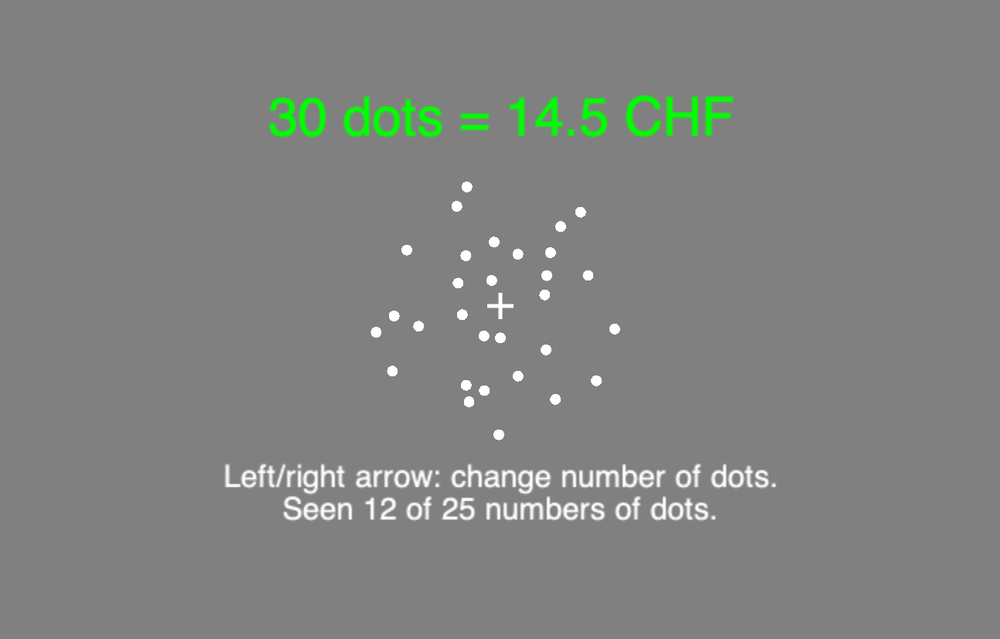
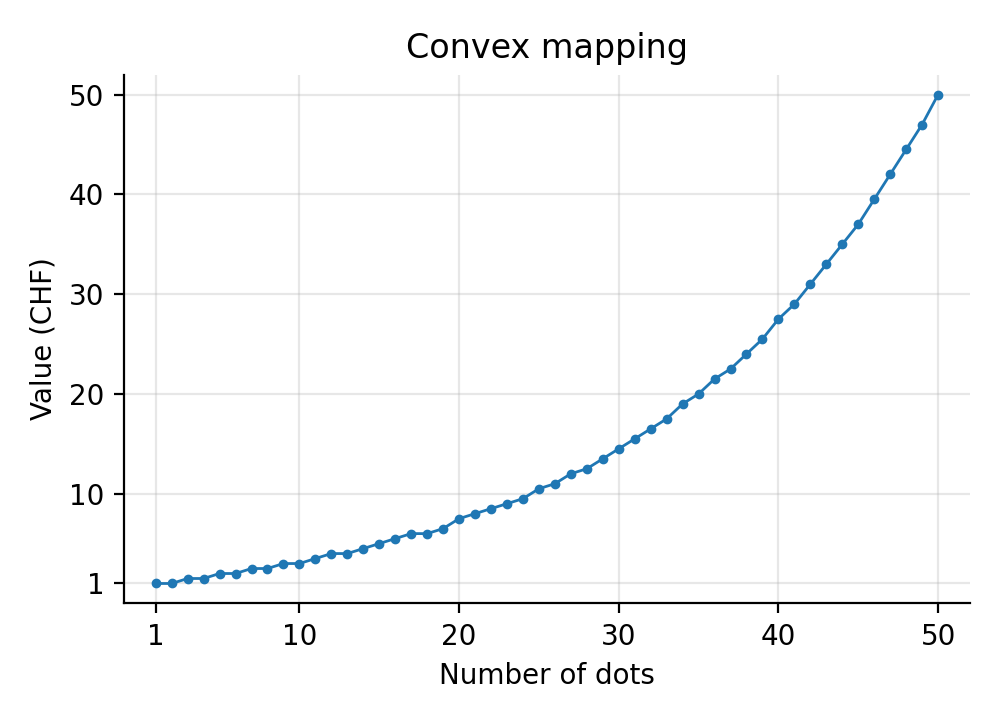
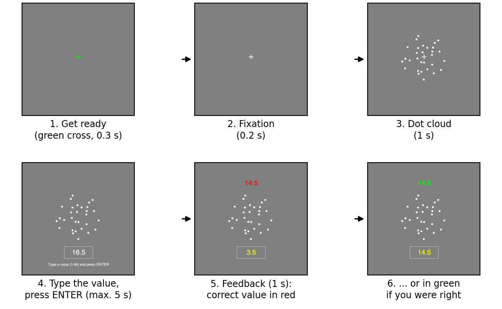
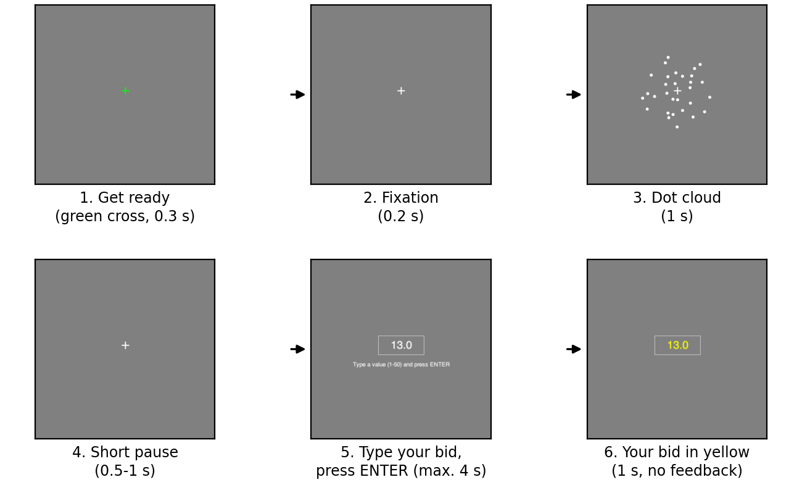
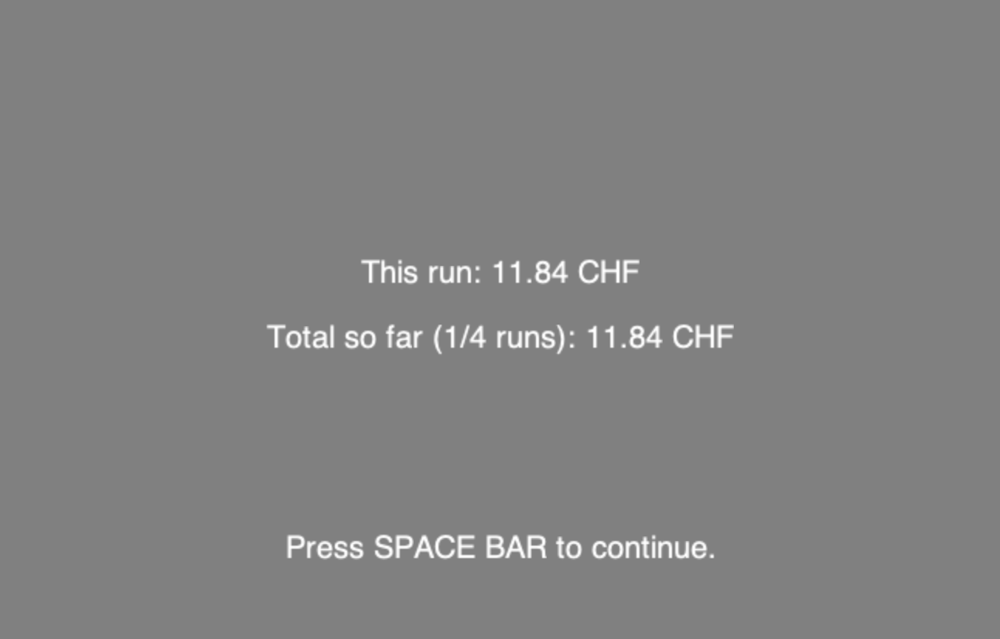

# Instructions (dot clouds, CONVEX mapping)

Welcome to this study, and thank you for participating!

Please read the following pages carefully. They explain the task and how you will be paid.

## Overview

The study consists of **4 sessions of about one hour each**, on separate days. **In every session you learn a new
relationship between dot clouds and money**, so you will get a new booklet each time. Every
session follows the same three phases:

1. **Learn** (Phase 1): you look at 25 dot clouds, spread evenly between 1 and 50 dots, together with their monetary values, at your own pace.
2. **Practice with feedback** (Phase 2): you see a dot cloud, type its value, and are shown the correct value.
3. **Auction** (Phase 3): you see a dot cloud and bid for it in an auction. There is no feedback. **This phase determines
   your bonus.**

Your task is to learn the relation between the number of dots in a cloud of dots and its monetary value. Each dot cloud has a specific monetary value assigned to it according to its number of dots (like a bank note). A cloud can have any number of dots from 1 to 50. **Note:** you will not have time to count the dots one by one. Use your impression of how many dots there are. The dots are placed at new random positions every time, so learn how the value changes with the number of dots rather than memorizing particular clouds.

## Payment

| | |
|---|---|
| Show-up fee | **15 CHF per session** |
| Auction bonus (Phase 3) | between 10 and 20 CHF per session, on average about **11 CHF** if you bid well |
| Completion bonus | **20 CHF** after you have completed all 4 sessions |
| **Total (typical)** | **about 123 CHF** for all 4 sessions |

You are paid at the end of each session; the completion bonus is paid at the end of session 4. How the auction
bonus is computed is explained under Phase 3. In short: the better you know the value of each dot cloud, and the more
consistently you bid that value, the more you earn.

Before you start, the experimenter will ask you a few questions to make sure you understand the task and the payment.

## Phase 1: learn the values

**You are shown 25 dot clouds, spread evenly between 1 and 50 dots, together with their monetary values (Figure 1).** Press the RIGHT ARROW to see the next
dot cloud and the LEFT ARROW to go back. Take as long as you like. Once you have seen all of them, press the SPACE BAR to
continue.

{width=3.5in}

*Figure 1: Phase 1 screen, showing one dot cloud (30 dots) together with its value (14.5 CHF). The text at the bottom counts how many you have seen.*

The values range from 1 to 50 CHF. Figure 2 shows exactly how the value depends on the number of dots. The relationship between the number of dots and the value is not linear: the value rises only slowly for small numbers of dots and then increases steeply for large numbers of dots. For example, going from 1 to 8 dots increases the value by only 1.5 CHF (from 1 to 2.5 CHF), whereas going from 39 to 46 dots increases the value by 14 CHF (from 25.5 to 39.5 CHF). This is the relationship you need to learn.

{width=4in}

*Figure 2: The value of each dot cloud (CONVEX mapping). Each session has a different relationship; this booklet is for today's.*

## Phase 2: practice with feedback

**You see a dot cloud and type its value.** Each round runs as in Figure 3:

{width=6.5in}

*Figure 3: One round of Phase 2.*

1. A green cross tells you that a new round starts; it turns white.
2. The dot cloud appears in the centre and stays on the screen.
3. After 1 second a box appears below it. Type the value (in steps of 0.5, for example 23.5) and **press ENTER**. You can correct
   typing errors with BACKSPACE. Only values between 1 and 50 are accepted. You have 5 seconds.
4. Your answer turns yellow and the correct value appears above the dot cloud. If your answer is exactly right, the correct value is shown in green; otherwise it is shown in red. If you do not press ENTER in time,
   you see "Too late!".

For every dot cloud, ask yourself: **what is this dot cloud worth? How much money would I get if I sold it?**

There are 138 rounds in 6 blocks, with a short break between
blocks. The numbers of dots are drawn at random, evenly spread between 1 and 50, so you will also see numbers of dots that were not among the examples in Phase 1. Phase 2 itself is not paid, but it is your chance to learn the values precisely: **the better you learn
them here, the more you will earn in Phase 3.**

## Phase 3: the auction

**You see a dot cloud and bid for it.** Each round runs as in Figure 4:

{width=6.5in}

*Figure 4: One round of Phase 3.*

The differences from Phase 2 are: the dot cloud disappears before you answer, you have only **4 seconds**,
and **there is no feedback**. Type your bid and **press ENTER**. **If you do not press ENTER in time, your bid is not
registered and you earn nothing in that round** (not even the budget explained below).

Phase 3 has 4 runs of 46 rounds. After each run you see what you earned so far (Figure 5).

{width=3in}

*Figure 5: The screen at the end of each run (example amounts).*

### How the auction works

Every round works the same way:

1. You get a **budget of 50 CHF** for this round.
2. You **bid**: the most you would pay for the dot cloud.
3. The computer draws a **random price** between 1 and 50 CHF. Every price is equally likely, and your bid does
   not influence it.
4. If your bid is **higher than the price**, you buy the dot cloud: you pay the price and receive its true value.
   Otherwise you buy nothing and keep the 50 CHF.

| Example: the dot cloud is worth 30 CHF and you bid 30 | Your result for this round |
|---|---|
| The price is 12: you buy | 50 − 12 + 30 = **68 CHF** |
| The price is 40: you do not buy | **50 CHF** |

**Your bonus.** The round results are not paid out one by one. At the end of the session we take your **average
result over all 184 rounds** and pay you **one fifth of it**: an average of 60 CHF, for example, gives a bonus of
12 CHF. A round gives between 50 and almost 100 CHF, so the bonus is between 10 and 20 CHF; with good bids it is
about 11 CHF. A round without a bid (no ENTER in time) counts as 0 CHF.

### Why you should always bid the true value

You might think it is better to bid less than the dot cloud is worth. **This is incorrect.** The price you pay is the
random price, not your bid. Your bid only decides *whether* you buy.

For example, suppose the dot cloud is worth 20 CHF:

- If you **bid 20**, you buy whenever the random price is below 20, so you always pay less than it is worth and make a
  profit.
- If you **bid less, say 5**, you still pay the same random price when you buy, but you miss all the chances to buy it
  at a price between 5 and 20. You lose profit.
- If you **bid more, say 35**, you also buy when the random price is between 20 and 35. Then you pay more than the
  dot cloud is worth and lose money.

So there is no way to game the auction. **The best you can do in every round is to bid what you believe the dot cloud is
truly worth.** When you buy, you pay on average about half of the value.

### In short

1. You bid on 184 dot clouds per session (4 runs of 46).
2. Treat every bid as if it were the only one.
3. Always bid the value you believe is correct, and press ENTER within 4 seconds.
4. Your bonus is one fifth of your average round result (an average of 60 CHF gives 12 CHF): between 10 and 20 CHF,
   about 11 CHF with good bids.
5. Together with the show-up fee of 15 CHF, you earn about 26 CHF per session, plus 20 CHF after
   the last session.

Thank you again for participating!
