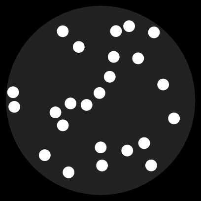
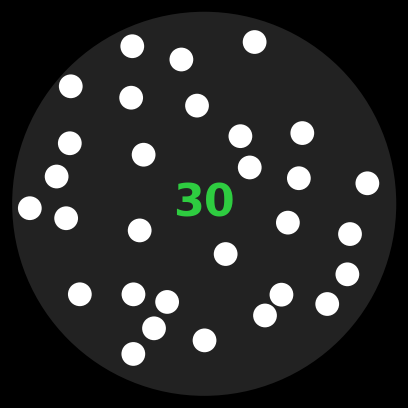
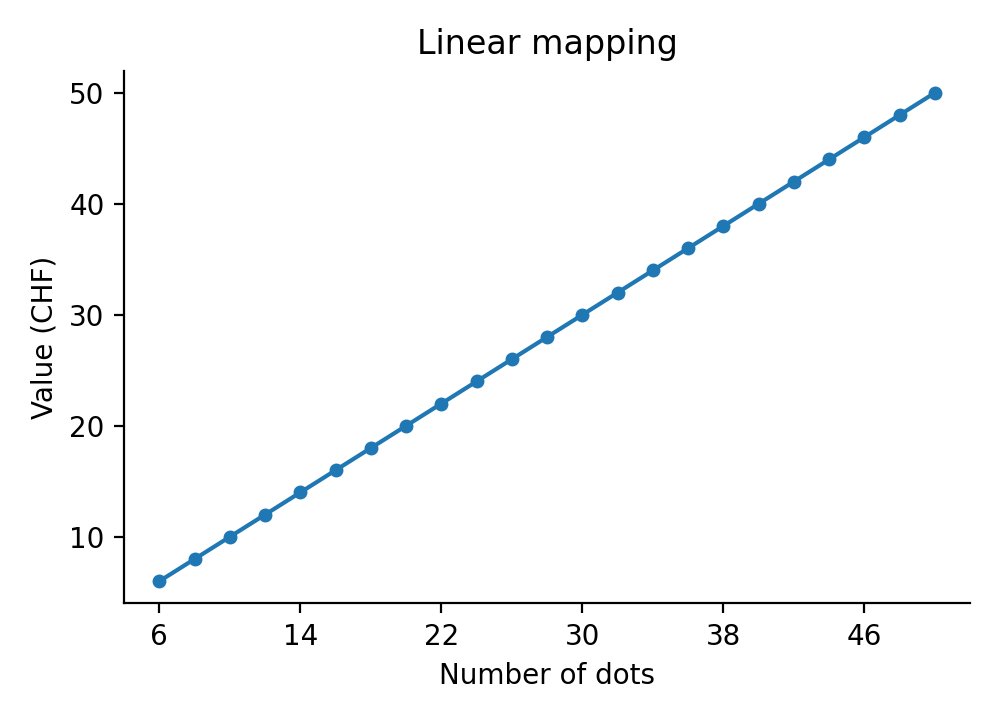

# Instructions (mapping LINEAR)

Welcome to this study! And thank you for participating.

Please carefully read the material on the following pages to understand:

- The task you will complete today.

- The rules of how you will be paid out.

Your task today will be to learn the relation between the number of dots
in a cloud of dots (Figure 1 shows you an example) and its monetary
value. Each dot cloud has a specific monetary value assigned to it
according to its number of dots (like a bank note). The number of dots
ranges from 6 to 50, in steps of 2, so there are 23 different dot
clouds. To learn the relation, you will first be shown all possible dot
clouds together with their corresponding monetary value (Phase 1). After
that you will be shown a random dot cloud and you need to input the
monetary amount that matches its value. You will get feedback on this
(Phase 2). Finally, you will again be shown a dot cloud and can bid
money to purchase it. Later, you can sell it for its actual monetary
value that you learned in the previous phase (Phase 3). Since your bid
is the maximum price you will have to pay to buy the dot cloud (the
price is randomly determined, up to your bid), you are best off to bid
the real monetary value of the dot cloud. In this phase, there is no
feedback. So, in the end, you will be paid according to how well you
learned the relationship between the number of dots and their values in
phase 2, and according to the difference between the random price set by
the computer if you won the bid and the resell value of the dot clouds
you purchased in phase 3.

{width=1.8in}

*Figure 1: Example of a dot cloud (here: 24 dots).*

**Note:** you will not have time to count the dots one by one. Use your
impression of how many dots there are. Each dot cloud is shown for 1 second. **TODO(Gilles)**: keep this note?

We will now explain each phase in detail. After this, **there will be a
few test questions** to make sure you properly understand the experiment
and the payout scheme.

By agreeing to participate, you have already earned a show-up fee of
**TODO(Gilles)** CHF. It is **very** important that you understand the following
instructions, since the additional payoffs from participating in the
experiment will depend on your ability to make good decisions. Thank you
again for participating in this experiment!

## Experiment Description

## [First phase of the experiment]{.underline}

**In the first phase of the experiment, you learn the monetary value of
the different dot clouds. You are shown all possible dot clouds together
with their corresponding monetary values in the middle (see Figure 2).**
You can look at the dot clouds and their numerical values for as long as
you want. Press the RIGHT ARROW to see the next dot cloud and the LEFT
ARROW to go back. Once you have seen all dot clouds, press the SPACE BAR
to continue.

{width=1.8in}

*Figure 2: Example of one dot cloud (30 dots) together with its
corresponding correct value (30 CHF) in the middle.*

The values of the dot clouds range between 6 and 50. The value is a
function of the number of dots. The exact function is shown in Figure 3.
The relationship is linear: the value of a dot cloud (in CHF) is simply equal to its number of dots. Each additional dot adds the same amount of money, wherever you are on the scale -- for example, a cloud with 20 dots is worth 20 CHF and a cloud with 40 dots is worth 40 CHF. So, this is what you are supposed to learn.

{width=4.2in}

*Figure 3: Mapping function from the number of dots to its value
(LINEAR mapping).*

Pay close attention during this phase of the experiment already. You
need to learn this exact relationship to earn the maximum money
possible.

## [Second phase of the experiment]{.underline}

**In the second phase of the experiment, you will be shown a dot cloud
and have to input its associated monetary value.** The dot cloud will be
shown in the center of your screen for 1 second, after which a response slider appears (see
Figure 4).

[Figure: example training trial -- dot cloud, response slider, and feedback; **TODO(Gilles)**: add screenshot of the numerosity version]

*Figure 4: Example of one training trial with negative feedback, where
the actual value is 30 and the input was 3.5.*

For each round, your task is to input a monetary value so that it
matches the value of the number of dots of the dot cloud that you
learned in phase 1. Move the slider to the value you believe corresponds
to the dot cloud and **click to confirm**. If your input matches the monetary value
of the dot cloud exactly, you will be shown green feedback. If the value
does not match the monetary value of the dot cloud, you will be shown
red feedback. Above the dot cloud, you will be given the
actual value of the dot cloud. For every dot cloud, you should ask
yourself: **What is the monetary value of this dot cloud? That is, how
much money would I get if I sold this dot cloud?** You have 5
seconds to make a guess. In total, you will complete 138 rounds in this
phase of the experiment (6 blocks) for 23 different dot clouds. This means that you
will see every dot cloud 6 times. The sequence of dot clouds is
completely random.

Try to predict the monetary value of the dot clouds in this phase as
accurately as possible. **Your payment will depend on how well you have
learned this relationship.** You will earn more if you are able to guess
the associated value of the dot cloud with the **least possible
difference to the true value in each guess**.

**Note:** You will have the opportunity to take short breaks between
blocks. Use this time to rest if needed, but remember that your
performance -- and thus your earnings -- will depend on your focus and
accuracy.

## [Third and final phase of the experiment]{.underline}

**In the third and final phase of the experiment, you have to input the
monetary value of a presented dot cloud as a BID in an AUCTION (see
Figure 5).** The difference to the previous phase is that you will not
receive feedback and that you only have a very limited amount of time to
input a value (4 seconds). The value of the dot cloud is exactly
what you learnt in the first two phases of the experiment.

Your budget for each trial is 50 CHF. You will keep the rest of the
budget after paying the price of the dot cloud if you win the bidding.
The dot clouds you bought will be exchanged for money at the end of the
experiment, and you will get 1/184 of the money you win here as extra
payment. As you will see in a moment, your best strategy is to bid your
true value for the dot cloud.

[Figure: example phase 3 trial -- dot cloud and response slider, no feedback; **TODO(Gilles)**: add screenshot]

*Figure 5: Example of one phase 3 trial (final phase) in which you have
to input the value of the dot cloud without feedback.*

You can submit your value by confirming your response (**click the mouse
button**). **If you do not
confirm, your input will not be registered and you will not get any
payout for this trial!** You only have a limited time of 4 seconds
to input your value. To maximize your payment, you should always make a
choice within the given timeframe. At the beginning of this phase you
have the opportunity to test a trial two times before the actual trials
start.

In every auction there is a rule that determines the price at which the
items are sold. This auction is no different.

The rule for our auction is a bit unusual, but its implications are
straightforward: There is no way of gaming the auction, the BEST thing
that you can do in every trial is to ask yourself how much you would be
willing to pay to get THAT dot cloud and then bid the number closest to
that value.

What is the rule? At the end of each trial, the computer will choose a
random price for the dot cloud which will range between 6 and 50 (the
range of possible values of the dot clouds). If your bid is greater than
the random price, you will get the dot cloud for the random price. You
can then sell it in the end for its true value and earn the difference
between the true value and the random price you paid for it. If your bid
is less or equal than the random value, you will NOT get the dot cloud
but will not have to pay any money and won't earn any additional money
from this trial.

Why is it in your interest to bid the value closest to your true value
for the dot cloud?

You might think that your best strategy is to bid less than the dot
cloud is worth to you. This is INCORRECT. The payout you get is
determined by the random price that the computer draws (your earnings
are the difference between the true value of the dot cloud and the
random price you paid) and NOT by your bid. Thus, if you lower your bid
you would not be able to affect the payout, but might end up losing the
opportunity to get the dot cloud at a "good" price (and therefore not
earn any additional payout).

For example, suppose that the dot cloud is worth 20 CHF to you. If you
bid your true value, you will get the dot cloud if the random value is
anything between 6 and 20 CHF. You will not get the dot cloud if the
random value is 20 CHF or above. It follows that by bidding your true
value you make a "profit" since you always end up paying less than the
dot cloud is worth to you.

Clearly, you should never bid more than your true value. (If you bid
more than your true value and you win the bid for a price higher than
the true value, your payout will be negative.)

What happens if you bid less than you true value? For example, suppose
that you bid 6 CHF even though your true value is 20 CHF. In this case
you never get the dot cloud, which is not a good strategy since, when
you bid your true value, you pretty much always end up paying less than
the dot cloud is worth to you!

Note another attractive property of the auction rules: conditional on
getting the dot cloud (i.e, conditional on the random number being less
or equal to your bid), the price that you pay is on average half of your
bid.

Thus, if you follow your best strategy and always bid the true value, on
a typical trial you will get to buy the dot cloud at approximately half
its true value (and thus earn half its value as the corresponding
payout)!

Don't let the details of the experiment confuse you, phase 3 trials are
actually very simple:

1.  You will make bids for purchasing a dot cloud on 184 trials (4 runs of 46 trials).

2.  You should treat each decision as if it were the only one.

3.  Your best strategy is to always bid the number closest to your true
    value for getting that dot cloud at the end of the experiment.

4.  If you follow the best strategy, on average the price that you pay
    for a dot cloud will be half of the value you bid.

5.  In the end, you will get 1/184 of the total money you accumulated
    during the trials you participated in during this phase as real
    money. (Remember: If you do not submit a bid during a trial, this
    trial does not count as a trial that you participated in!)

6.  Your average payout in the task will be around 58 CHF (on top of the show-up fee).
