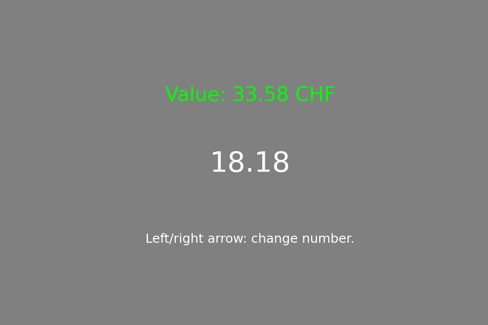
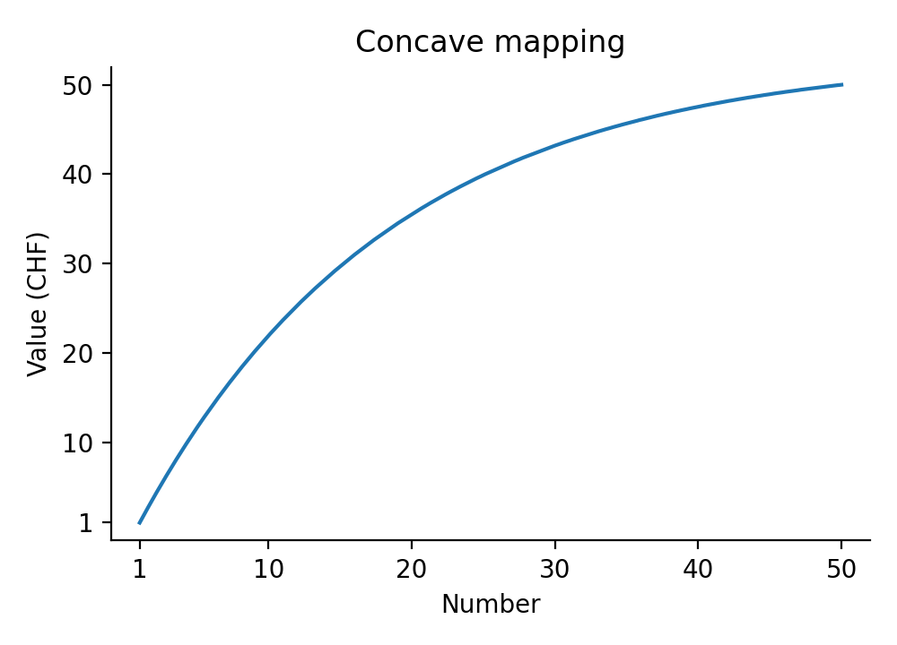
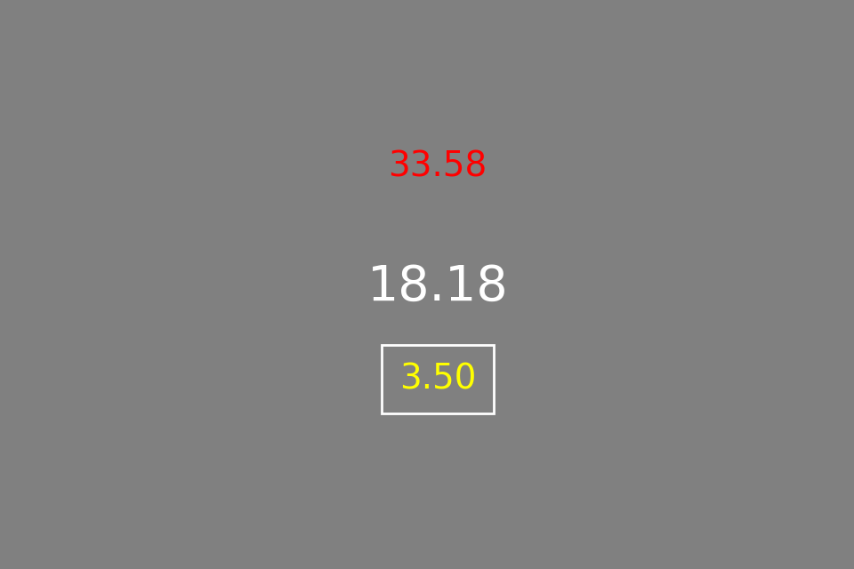
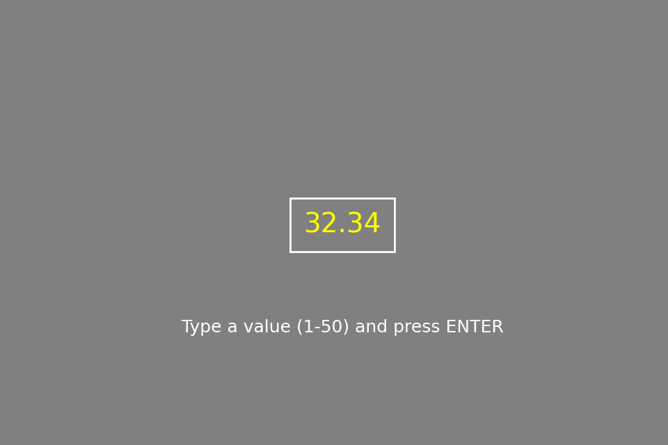

# Instructions (numbers, mapping CONCAVE)

Welcome to this study! And thank you for participating.

Please carefully read the material on the following pages to understand:

- The task you will complete today.

- The rules of how you will be paid out.

Your task today will be to learn the relation between a number and its monetary value. Each number between 1 and 50 has
a specific monetary value assigned to it (like a bank note). The numbers are shown with two decimals, for example
18.18. To learn the relation, you will first be shown 23 numbers spread evenly between 1 and 50, together with
their corresponding monetary value (Phase 1). After that you will be shown a random number and you need to input the
monetary amount that matches its value. You will get feedback on this (Phase 2). Finally, you will again be shown a
number and can bid money to purchase it. Later, you can sell it for its actual monetary value that you learned in the
previous phase (Phase 3). Since your bid is the maximum price you will have to pay to buy the number (the price is
randomly determined, up to your bid), you are best off to bid the real monetary value of the number. In this phase,
there is no feedback. So, in the end, you will be paid according to how well you learned the relationship between the
numbers and their values, and according to the difference between the random price set by the computer if you won the
bid and the resell value of the numbers you purchased in phase 3.

**Note:** new numbers keep appearing, so you cannot memorize a list. Learn how the value changes with the number. Each
number is shown for 1 second.

By agreeing to participate, you have already earned a show-up fee of **TODO(Gilles)** CHF. It is **very** important that
you understand the following instructions, since the additional payoffs from participating in the experiment will depend
on your ability to make good decisions. Thank you again for participating in this experiment!

## Experiment Description

## [First phase of the experiment]{.underline}

**In the first phase of the experiment, you learn the monetary value of the numbers. You are shown 23 numbers together
with their corresponding monetary values (see Figure 1).** You can look at the numbers and their values for as long as
you want. Press the RIGHT ARROW to see the next number and the LEFT ARROW to go back. Once you have seen all 23, press
the SPACE BAR to continue.

{width=3in}

*Figure 1: Example of one number (18.18) together with its corresponding correct value (33.58 CHF).*

The values of the numbers range between 1 and 50 CHF. The value is a function of the number. The exact function is
shown in Figure 2. As you can see, the relationship between the number and its value is not linear: the value rises steeply for small numbers and then flattens out for large numbers. For example, going from 1 to 13 increases the value by 25.84 CHF (from 1.00 to 26.84 CHF), whereas going from 30 to 42 increases the value by only 4.96 CHF (from 43.19 to 48.15 CHF). So, this is what you are supposed to learn.

{width=4.2in}

*Figure 2: Mapping function from the number to its value (CONCAVE mapping).*

Pay close attention during this phase of the experiment already. You need to learn this exact relationship to earn the
maximum money possible.

## [Second phase of the experiment]{.underline}

**In the second phase of the experiment, you will be shown a number and have to input its associated monetary value.**
The number will be shown in the center of your screen for 1 second, after which a response box appears (see Figure 3).

{width=3in}

*Figure 3: Example of one training trial with negative feedback, where the actual value is 33.58 and the input was
3.50.*

For each round, your task is to input a monetary value so that it matches the value of the number that you learned in
phase 1. Type the value you believe corresponds to the number (up to two decimals, for example 23.45) and **press ENTER to
confirm**. Only values between 1 and 50 are accepted. If your input is within 0.50 CHF of the monetary value of the
number, you will be shown green feedback. If it is further away, you will be shown red feedback. Above the number, you
will be given its actual value. For every number, you should ask yourself: **What is the monetary value of this number?
That is, how much money would I get if I sold this number?** You have 5 seconds to make a guess. In total, you will
complete 138 rounds in this phase of the experiment (6 blocks). The numbers are drawn at random, evenly spread between
1 and 50, so most numbers you see will be new.

Try to predict the monetary value of the numbers in this phase as accurately as possible. **Your payment will depend on
how well you have learned this relationship.** You will earn more if you are able to guess the associated value of the
number with the **least possible difference to the true value in each guess**.

**Note:** You will have the opportunity to take short breaks between blocks. Use this time to rest if needed, but
remember that your performance -- and thus your earnings -- will depend on your focus and accuracy.

## [Third and final phase of the experiment]{.underline}

**In the third and final phase of the experiment, you have to input the monetary value of a presented number as a BID in
an AUCTION (see Figure 4).** The difference to the previous phase is that you will not receive feedback and that you only
have a very limited amount of time to input a value (4 seconds). The value of the number is exactly what you learnt in
the first two phases of the experiment.

Your budget for each trial is 50 CHF. You will keep the rest of the budget after paying the price of the number if you
win the bidding. The numbers you bought will be exchanged for money at the end of the experiment, and you will get 1/184
of the money you win here as extra payment. As you will see in a moment, your best strategy is to bid your true value for
the number.

{width=3in}

*Figure 4: Example of the response screen of one phase 3 trial (final phase). The number has disappeared, and you input
its value without feedback.*

You can submit your value by confirming your response (**press ENTER**). **If you do not confirm, your input will not be
registered and you will not get any payout for this trial!** You only have a limited time of 4 seconds to input your
value. To maximize your payment, you should always make a choice within the given timeframe.

In every auction there is a rule that determines the price at which the
items are sold. This auction is no different.

The rule for our auction is a bit unusual, but its implications are
straightforward: There is no way of gaming the auction, the BEST thing
that you can do in every trial is to ask yourself how much you would be
willing to pay to get THAT number and then bid the amount closest to
that value.

What is the rule? At the end of each trial, the computer will choose a
random price for the number which will range between 1 and 50 (the
range of possible values of the numbers). If your bid is greater than
the random price, you will get the number for the random price. You
can then sell it in the end for its true value and earn the difference
between the true value and the random price you paid for it. If your bid
is less or equal than the random value, you will NOT get the number
but will not have to pay any money and won't earn any additional money
from this trial.

Why is it in your interest to bid the value closest to your true value
for the number?

You might think that your best strategy is to bid less than the number is worth to you. This is INCORRECT. The payout you get is
determined by the random price that the computer draws (your earnings
are the difference between the true value of the number and the
random price you paid) and NOT by your bid. Thus, if you lower your bid
you would not be able to affect the payout, but might end up losing the
opportunity to get the number at a "good" price (and therefore not
earn any additional payout).

For example, suppose that the number is worth 20 CHF to you. If you
bid your true value, you will get the number if the random value is
anything between 1 and 20 CHF. You will not get the number if the
random value is 20 CHF or above. It follows that by bidding your true
value you make a "profit" since you always end up paying less than the
number is worth to you.

Clearly, you should never bid more than your true value. (If you bid
more than your true value and you win the bid for a price higher than
the true value, your payout will be negative.)

What happens if you bid less than you true value? For example, suppose
that you bid 1 CHF even though your true value is 20 CHF. In this case
you never get the number, which is not a good strategy since, when
you bid your true value, you pretty much always end up paying less than
the number is worth to you!

Note another attractive property of the auction rules: conditional on
getting the number (i.e, conditional on the random number being less
or equal to your bid), the price that you pay is on average half of your
bid.

Thus, if you follow your best strategy and always bid the true value, on
a typical trial you will get to buy the number at approximately half
its true value (and thus earn half its value as the corresponding
payout)!

Don't let the details of the experiment confuse you, phase 3 trials are
actually very simple:

1.  You will make bids for purchasing a number on 184 trials (4 runs of 46 trials).

2.  You should treat each decision as if it were the only one.

3.  Your best strategy is to always bid the amount closest to your true
    value for getting that number at the end of the experiment.

4.  If you follow the best strategy, on average the price that you pay
    for a number will be half of the value you bid.

5.  In the end, you will get 1/184 of the total money you accumulated
    during the trials you participated in during this phase as real
    money. (Remember: If you do not submit a bid during a trial, this
    trial does not count as a trial that you participated in!)

6.  Your average payout in the task will be around 64 CHF (on top of the show-up fee).
